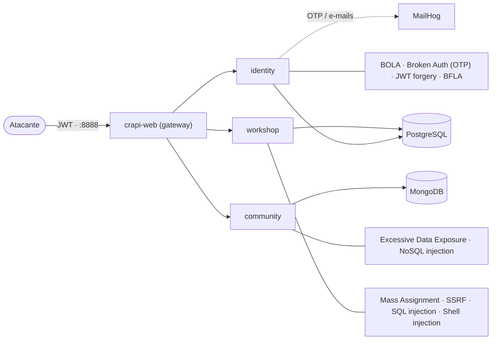
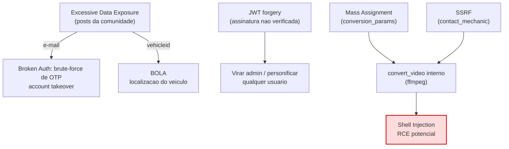

🇧🇷 Português · [🇺🇸 English](en/diagrams.md)

# Diagramas — arquitetura e encadeamento de ataques

Dois diagramas que ajudam a visualizar **onde** cada falha vive e **como** elas se combinam. Renderizam automaticamente no GitHub (Mermaid).

---

## 1. Arquitetura do crAPI e mapa das falhas

O gateway (`crapi-web`, porta 8888) encaminha para três serviços, cada um com seu armazenamento. O diagrama mostra também em qual serviço cada vulnerabilidade foi encontrada.

---

## 2. Encadeamento das vulnerabilidades

Poucas falhas são exploradas isoladamente: uma alimenta a outra. O **Excessive Data Exposure** entrega os insumos (e-mail, `vehicleid`) para o BOLA e o brute-force de OTP; e **Mass Assignment + SSRF** se combinam para alcançar a injeção de comando.

- **Caminho 1 (roubo de identidade/dados):** Excessive Data Exposure → OTP brute-force / BOLA.
- **Caminho 2 (bypass de autenticação):** JWT forgery → admin / personificação.
- **Caminho 3 (RCE):** Mass Assignment + SSRF → `convert_video` interno → Shell Injection.

Ver a análise completa de cada falha em [vulnerabilidades/](vulnerabilidades/) e o [relatório executivo](RELATORIO-EXECUTIVO.md).
