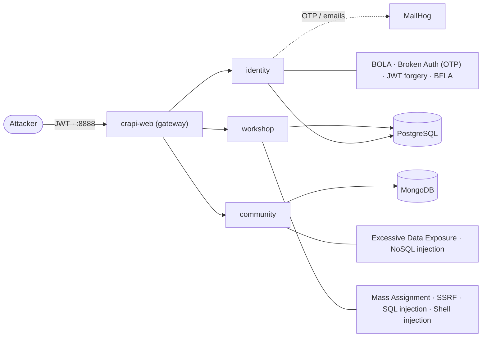
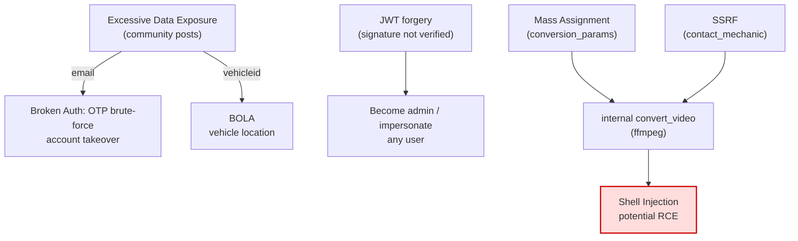

[🇧🇷 Português](../diagramas.md) · 🇺🇸 English

# Diagrams — architecture and attack chaining

Two diagrams that help visualize **where** each flaw lives and **how** they combine. They render automatically on GitHub (Mermaid).

---

## 1. crAPI architecture and flaw map

The gateway (`crapi-web`, port 8888) forwards to three services, each with its own storage. The diagram also shows which service each vulnerability was found in.

---

## 2. Vulnerability chaining

Few flaws are exploited in isolation: one feeds the next. **Excessive Data Exposure** supplies the inputs (email, `vehicleid`) for BOLA and the OTP brute-force; and **Mass Assignment + SSRF** combine to reach command injection.

- **Path 1 (identity/data theft):** Excessive Data Exposure → OTP brute-force / BOLA.
- **Path 2 (authentication bypass):** JWT forgery → admin / impersonation.
- **Path 3 (RCE):** Mass Assignment + SSRF → internal `convert_video` → Shell Injection.

See the full analysis of each flaw in [vulnerabilities/](vulnerabilities/) and the [executive report](executive-report.md).
